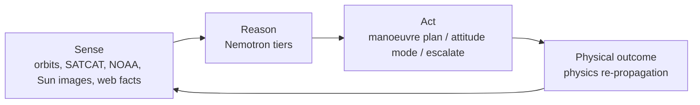
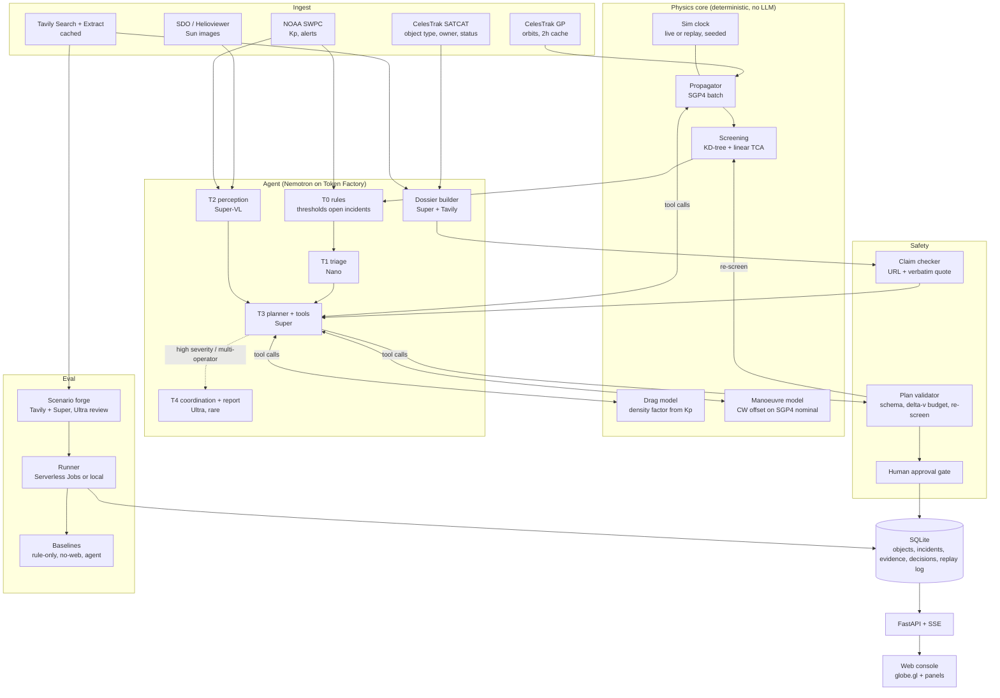

# CRIC architecture (draft)

CRIC (Cosmic Response & Intelligence Console, working title) is an AI mission-control console for small satellite operators. It watches real orbits and space weather, decides who should manoeuvre and how, checks every plan in physics before a human approves it, and is evaluated on scenarios built from real events.

## 1. Closed loop



The agent never moves anything directly. It proposes; the physics core simulates the result; a validator and a human gate decide.

## 2. Components



## 3. Model routing

| Tier | Model | Job | Called |
|---|---|---|---|
| T0 | none (rules) | open an incident when miss distance or Kp crosses a threshold | every screening pass |
| T1 | Nemotron 3 Nano | severity, incident type, which tools the planner needs | every incident |
| T2 | Nemotron 3.5 Super VL | read Sun image + NOAA data, drag-risk assessment with observed/inferred/unknown | on space-weather incidents |
| T3 | Nemotron 3 Super | choose among verified burn options or ask for data / coordinate / escalate (`cric.agent.decision`) | incidents T1 marks actionable |
| T4 | Nemotron 3 Ultra | message to the other operator, incident report | high severity or both objects can manoeuvre |
| Dossier | Super + Tavily | who can manoeuvre, every fact with URL + verbatim quote | once per object, cached |
| Forge | Super + Tavily, Ultra review | scenario JSON from real events | offline |
| (option) | Nemotron 3.5 Lightning | summarise long replay logs (1M context) | report time |

All calls use `response_format: json_schema` and a large `max_tokens`, because Nemotron spends a large share of output tokens on reasoning. `reasoning_content` is stored and shown in the UI as the decision trace.

## 4. Division of labour (updated)

The spike version let Nemotron search burn parameters with tools. It reached a valid burn but used 45% more
delta-v than the exhaustive optimiser, in 116 s instead of under a second. Numeric search now belongs to
`cric.physics.options` (min_dv, latest, out_of_plane options, each re-screened). Nemotron decides *whether,
who, which option and who to tell*, and `cric.safety.validator` enforces the hard rules in code.

## 4b. Agent tools (T3, spike version)

| Tool | Effect | Backed by |
|---|---|---|
| `get_incident(id)` | read | DB |
| `get_conjunction(id)` | read: TCA, miss distance, relative speed, altitude | screening |
| `get_dossier(norad)` | read: capability facts with citations | dossier builder |
| `get_space_weather()` | read: latest T2 assessment + Kp | T2, SWPC |
| `propagate(norad, t0, t1)` | read: positions | SGP4 |
| `simulate_maneuver(norad, dv_rtn, t_burn)` | read: new miss distance for this pair | manoeuvre model |
| `rescreen(norad, plan, window_h)` | read: new conjunctions the plan would create | screening |
| `propose_plan(plan)` | proposal: goes to validator | validator |

The planner cannot execute anything. `propose_plan` is the only exit.

## 5. Data contracts

```text
Fact          { value, status: sourced|inferred|unknown, source_url, quote, note }
Incident      { id, kind: conjunction|space_weather, objects[], opened_at, severity, state }
Dossier       { norad, operator, has_propulsion: Fact, can_maneuver_now: Fact, ... }
ManeuverPlan  { incident_id, actor_norad, action: BURN|ATTITUDE_MODE|DELAY|NO_ACTION|ESCALATE,
                dv_rtn_mps?, burn_time?, expected_miss_km, new_conjunctions[], rationale, evidence[] }
Decision      { plan_id, validator_result, human: approved|rejected|pending, executed_in_sim_at }
```

## 6. Safety rules (code, not prompts)

1. Debris, rocket bodies and decayed objects cannot manoeuvre (SATCAT overrides the web).
2. A capability fact counts only if it is `sourced`, passes the claim check, and is not from a social-media domain. Otherwise it is `unknown`.
3. Unknown capability on either side means `ESCALATE`, never a guess.
4. A plan is rejected if it exceeds the delta-v budget or creates a closer conjunction within the re-screen window.
5. Nothing is applied to the simulation without the human gate (auto-approve only in eval runs).

## 7. Physics notes and limits

- Screening: SGP4 on CelesTrak GP data, KD-tree coarse pass, linear closest-approach refinement. Accuracy about 1 km; no covariance or Pc.
- Manoeuvre: small burns modelled as a Clohessy-Wiltshire offset added to the SGP4 nominal path of the manoeuvring object. Good for hours to a day after the burn; not a precise orbit-determination tool.
- Drag: simple exponential atmosphere with a density factor driven by Kp, used for the storm scenarios (orbit decay of low deployment orbits). Calibrated only roughly; stated in LIMITATIONS.

## 8. Evaluation

| Arm | What it gets |
|---|---|
| Rule-only | manoeuvre if miss < threshold; no capability check, no weather |
| Agent, no web | full agent, Tavily disabled (dossiers from SATCAT only) |
| Agent | full agent |

Metrics: unsafe outcomes (collision or loss in sim), unnecessary manoeuvres, wrong-actor manoeuvres (asked a non-manoeuvrable object to move), escalation rate, delta-v used, cost and latency per incident, citation pass rate.

Scenarios: real current conjunctions from screening, plus forged scenarios from real events (Feb 2022 storm, Iridium 33 / Cosmos 2251, 2021 ASAT debris) with parameter variations.

## 9. Repository layout

```text
cric/
  src/cric/
    ingest/      celestrak.py satcat.py swpc.py sun_images.py tavily_cache.py
    physics/     propagate.py screen.py maneuver.py drag.py clock.py
    agent/       llm.py (structured_call, routing) triage.py perception.py planner.py
                 coordinator.py dossier.py tools.py schemas.py
    safety/      claims.py validator.py approval.py
    scenarios/   forge.py library/*.json
    eval/        runner.py baselines.py metrics.py
    store/       db.py
    api/         app.py (FastAPI, SSE)
  web/           index.html globe.js panels/
  jobs/          eval_job.py (Serverless Jobs entry)
  spike/         feasibility scripts 00-04
  README.md ARCHITECTURE.md LIMITATIONS.md FEEDBACK.md LICENSE .env.example
```

## 10. Runtime modes

| Mode | Data | Token Factory calls | Use |
|---|---|---|---|
| Live | current CelesTrak + NOAA | yes | demo, development |
| Replay | recorded run from DB | no | judging fallback, credit-safe |
| Eval | scenario library | yes, batched | results table |

## 11. Open technical questions

- Whether Serverless Jobs can run CPU-only workloads; if not, run eval locally and say so.
- Where to host the API for judges (Serverless Endpoint vs. a small VM); replay mode keeps the UI working if credits run out.
- Drag model calibration against the Feb 2022 numbers (38 of 49 lost, ~210 km deployment perigee).
- Fleet-level vs unit-level facts in dossiers (e.g. LEMUR-2 constellation vs one satellite).
