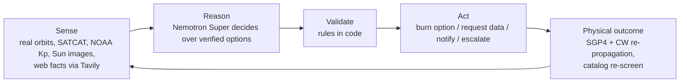
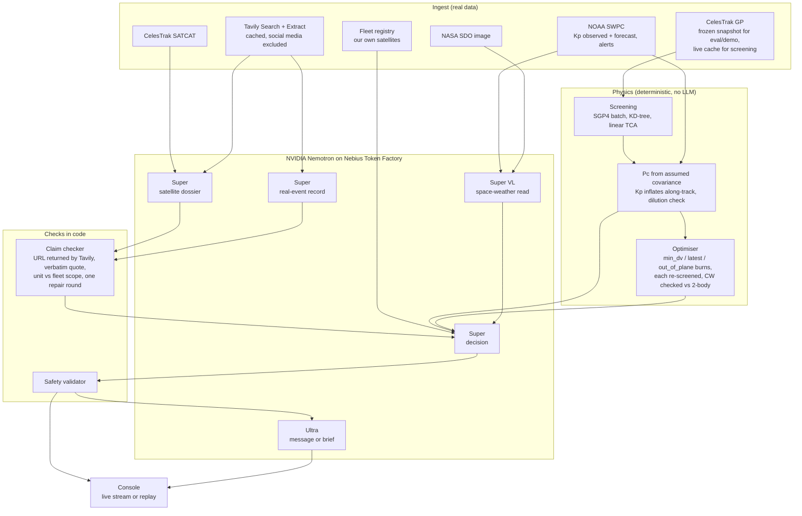

# CRIC architecture

CRIC (Cosmic Response & Intelligence Console) is decision support for small satellite operators facing a predicted
close approach. Deterministic code does everything that can be computed; NVIDIA Nemotron does the judgement that
needs reading; hard rules are enforced in code; a person approves anything that moves a satellite.

## 1. Closed loop



## 2. Components



## 3. Who does what

| Work | Done by | Why |
|---|---|---|
| Orbit propagation, screening, burn effect, re-screen | Code (SGP4, Clohessy-Wiltshire) | Exact and fast; never sent through a model |
| Choosing the burn parameters | Optimiser | The first spike let Nemotron search with tools: valid burn, 45% more delta-v, 116 s |
| Collision probability | Code, assumed covariance | No CDMs in public data; labelled "assumed" or "simulated" everywhere |
| Kp used for the covariance | NOAA numbers | The VL model's read is context, not an input to physics |
| Image read vs NOAA | Code (`perception.cross_check`) | If the image reads higher drag risk than Kp implies, flag it and require a recheck time; never changes Pc |
| Sun image + NOAA read | Nemotron 3.5 Super VL | Qualitative read with observed / inferred / unknown |
| Who can manoeuvre (other object) | Nemotron Super + Tavily, claim-checked | Facts are scattered across operator pages and papers |
| Who can manoeuvre (our satellite) | Fleet registry | An operator knows this from telemetry, not the web |
| Act, wait for data, notify or escalate; which option | Nemotron Super | Needs policy and mission notes written in plain language |
| Hard rules | Safety validator (code) | Checkable on structured fields; a prompt can be ignored |
| Message to the other operator / brief for the on-call engineer | Nemotron Ultra | Runs only when a person must act |

Every call uses `response_format: json_schema` plus an explicit JSON skeleton in the prompt, a 16k token budget
(reasoning counts against it) and retries with backoff for 503s.

## 4. Safety validator rules

The validator never makes a decision riskier; it accepts, or overrides to a safer action and records why.

1. A burn must use an option the optimiser verified.
2. Our propulsion must be verified ("yes"); otherwise escalate.
3. The burn must leave the command-upload window from now and stay under the policy delta-v cap.
4. The burn must not fall in a structured mission blackout.
5. On a diluted or yellow Pc with time before the latest burn, get precise data first.
6. If the other object can manoeuvre, or is an operational satellite with unknown propulsion, notify before burning.
7. Monitoring a red, non-diluted Pc is escalated.
8. Coordinating with an intended burn drops the burn when our propulsion is unverified.

Constraints that exist only in free text are not enforced by the validator; that is where the model must read.

## 5. Data

| Data | Where | Notes |
|---|---|---|
| Frozen orbits + 24 h screening | `fixtures/snapshot_20261025/` | Eval and demo read only this; reproducible |
| Fleet registry | `fixtures/fleet.json` | Demo assumption: we operate EOS-08 |
| Live orbits, caches, recordings, eval runs | `data/` (git-ignored) | `cric screen` writes here only |
| Static demo recordings | `web/demo/` | `scripts/export_demo.py` |

## 6. Evaluation

Three sets on real encounters: tuning (13), held-out (9, answers committed before running), and real storms
researched with Tavily (1989, 2003, 2022, 2024) replayed as current conditions. Arms: rule of thumb, coded policy
over structured fields, Nemotron Super, Nemotron Nano; each answer graded raw and after the validator.
`cric eval --regrade FILE` re-applies the current validator to saved decisions without model calls.
Results in README.

## 7. Runtime modes

| Mode | Model calls | Use |
|---|---|---|
| Live (`web/serve.py`, Run live) | yes | real time when TCA is at least 2 h ahead, otherwise as if 3 h before TCA |
| Replay (server) | no | recorded trace of a live run |
| Static (GitHub Pages) | no | same replays without a server; judging fallback |
| Eval (`cric eval`) | yes | results table |

## 8. Repository layout

```text
src/cric/
  config.py llm.py pipeline.py cli.py
  ingest/    celestrak.py (GP, SATCAT, snapshot) swpc.py (NOAA)
  physics/   screen.py maneuver.py options.py risk.py timeutil.py
  research/  dossier.py (satellite facts) forge.py (real events)
  agent/     decision.py perception.py report.py
  safety/    validator.py
  eval/      scenarios.py runner.py
web/         index.html serve.py demo/
fixtures/    snapshot_20261025/ fleet.json
scripts/     export_demo.py
tests/       offline tests (physics, validator, grader)
spike/       original feasibility scripts, kept for the record
```
