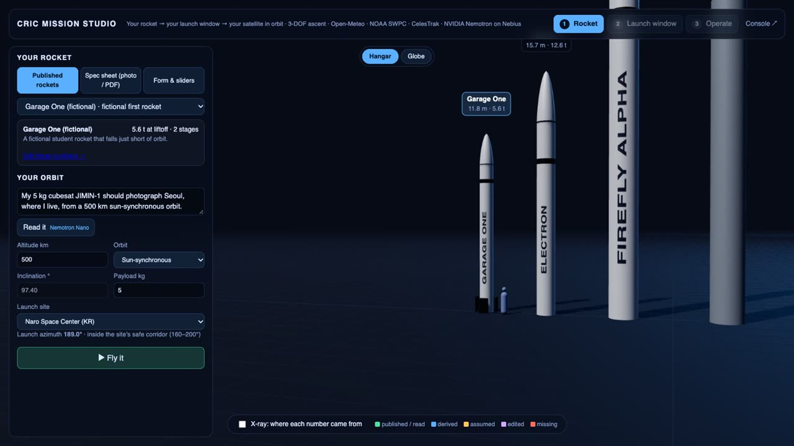
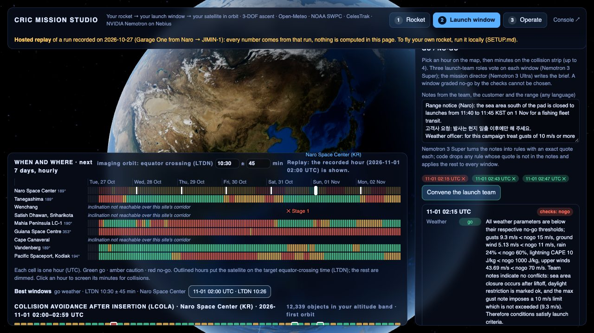
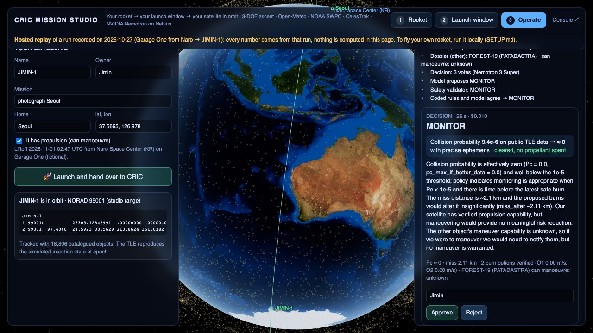
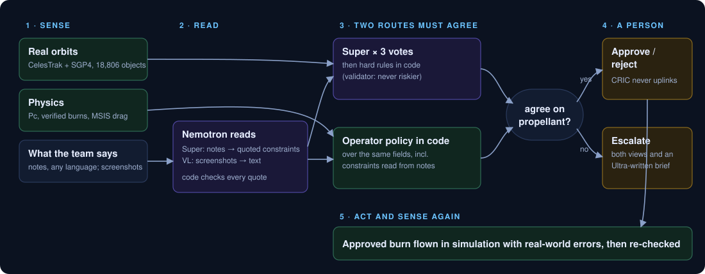

# CRIC: mission rehearsal for small satellite teams

**Who it is for.** A university cubesat team or a small satellite startup: no flight dynamics department, mission
constraints scattered across chat threads, range notices and spreadsheets (in more than one language), and orbit
data from the public catalog. **What it does.** CRIC turns those into decisions the team can review, rehearsing the
mission end to end: can this rocket get our satellite to its orbit, when should we launch, and what do we do when
something comes close or we want to move. Every decision comes with its evidence, the checks it passed and a
person's sign-off. CRIC finds the risks and rules to check; it does not guarantee safety, and it has not yet been
tried by a real operations team (that is the next step).

Built for the [Nebius x NVIDIA Global AI Hackathon](https://nebiusglobalaihackathon.devpost.com/).

**Live demo, no install: https://youngjun-choi-kr.github.io/cric/** · **Demo video:** *(link added at submission)*
- **Mission Studio** (rocket, launch, operate): a recorded run of the JIMIN-1 story, replayed in the page. All five
  rockets fly in step 1; in step 3 the two goal burns ("lower it", "raise it") and CRIC's safer times are recorded.
- **Operations console**: recorded conjunction decisions; pick a situation and press *Replay recorded run*.

Both run live (your own rocket, live decisions) with the local server and API keys: [SETUP.md](SETUP.md).
Architecture: [ARCHITECTURE.md](ARCHITECTURE.md) · limits: [LIMITATIONS.md](LIMITATIONS.md).

| 1 · The ride to orbit | 2 · When and where | 3 · Operate |
|---|---|---|
|  |  |  |
| Does it make it to orbit? If not, test-flown fixes. | Weather, time of day, your team's notes, and a collision check for every minute. | Passes over home, close approaches, your own burns (CRIC checks each), your final call. |

**In one minute**
- **The ride to orbit.** Pick a real rocket, drop in a spec sheet (Nemotron 3.5 Super VL reads it and labels every number),
  or type your own. Watch it fly in 3D. If it falls short, CRIC suggests fixes and test-flies each one first.
  500 test flights with the forecast winds show where the spent stages land, and whether that's at sea.
- **When and where.** A week of weather for every launch site. For a camera satellite, the hours that give the
  right time of day over the ground. Your team's notes, in any language, become rules the code can check. Every
  launch minute is checked against the satellites already up there. Three officers vote, and Nemotron 3 Ultra
  makes the call, but can't overrule a veto.
- **Operate.** The satellite joins the catalog. When something comes close, CRIC works out the risk, checks
  each possible burn against every other object, looks up the other satellite with cited sources, and decides.
  No burn happens unless Nemotron 3 Super's three votes and the rules in code agree; otherwise a person decides.
  A person always signs off. CRIC never sends commands to a spacecraft.
- **Mission control.** You can also fly the satellite yourself: pick a burn (when, which way, how big). CRIC
  works out the new orbit, checks it against every tracked object for 3 days, counts the propellant, and says
  how long the satellite will stay up (and whether it meets the 5-year deorbit rule). If the burn is risky, it
  offers the same burn a few minutes earlier or later. You approve; every command goes into a hash-chained log.
  A mission clock (up to ×3600), a ground track, and a photo planner for any place on the globe.
- **Tested.** Test sets written before running, screening checked against CelesTrak SOCRATES, collision math
  against NASA test cases, the rocket model against published capacities. See Results.



## How it uses Nebius and NVIDIA

| Piece | Model / service | Role |
|---|---|---|
| Screen reading | NVIDIA Nemotron 3.5 Super VL on Nebius Token Factory | reads screenshots the team shares (planning calendars, telemetry panels, chats) into text that becomes enforceable constraints; 8/8 on our screenshot test. Its read of the Sun showed no forecasting signal, so it no longer runs by default |
| Decisions | NVIDIA Nemotron 3 Super | choose among physics-verified burn options, ask for data, coordinate or escalate |
| Satellite dossiers, real-event records | NVIDIA Nemotron 3 Super + Tavily | capability facts and storm records, every fact cited with a verbatim quote |
| Human-facing documents | NVIDIA Nemotron 3 Ultra | coordination message or escalation brief, only when a person must act |
| (evaluated, not routed) | NVIDIA Nemotron 3 Nano | slower and less accurate than Super for these decisions; see Results |
| Mission Studio | Nano · Super · Ultra · 3.5 Super VL | Nano reads the owner's plain-language target orbit; VL (images) or Super (PDF text) transcribes a rocket spec sheet; Super explains a failed flight, turns team / customer / range notes into rules with exact quotes, and casts the weather, range and orbital-safety votes; Ultra is the mission director who writes the launch brief |
| Web grounding | Tavily Search + Extract | satellite facts and real space-weather events for the eval |

Orbit math never goes through an LLM: screening uses SGP4 on CelesTrak data, and safety rules are enforced in code.

## Quick start

```bash
python3 -m venv .venv && .venv/bin/pip install -e ".[dev]"
cp .env.example .env                          # add NEBIUS_API_KEY and TAVILY_API_KEY (see SETUP.md)
.venv/bin/cric screen --hours 6               # real close approaches from CelesTrak
.venv/bin/cric incident --ours 60454 --other 61786   # EOS-08 x SITRO-AIS 38, decided at TCA - 3 h
.venv/bin/python web/serve.py 8765            # console http://localhost:8765 · Mission Studio /studio.html
.venv/bin/python -m pytest -q                 # offline tests: physics, safety rules, studio API, browser replays
```

An incident runs: SGP4 geometry -> Pc from an assumed covariance -> verified burn options from the optimizer
-> cited dossiers for both objects (Tavily + Nemotron, with a verifier repair loop) -> Nemotron decision
(MANEUVER / REQUEST_PRECISE_DATA / MONITOR / COORDINATE / ESCALATE), three independent votes, a split goes to a
person -> safety validator in code -> Ultra brief when a person must act -> approve / reject in the console.

**Unattended:** `cric watch` screens a fresh catalog every 30 minutes, runs the pipeline for any encounter with
our fleet, and notifies a person; it runs as a Nebius Serverless AI Job ([deploy/nebius](deploy/nebius/README.md)).

The numeric search is done by the optimizer, not the model: Nemotron chooses among options that physics has
already checked, using context the optimizer cannot read (policy and mission notes in plain language, evidence
quality, time left for better data). `archive/spike/` keeps the original day-1 feasibility scripts.

## Results

**At a glance**

| What | Result |
|---|---|
| Conjunction decisions, held-out 3 (written after the final design, run once) | pipeline 11/12 scenarios; no policy-violating burn in any of the 138 test runs (our scenarios, not a safety rate) |
| Screening vs CelesTrak SOCRATES | 99.7% of encounters found |
| Pc vs NASA CARA test cases | matches |
| Studio notes → rules, held-out (written after the fixes, run once) | 24/24 runs |
| Studio mission director | 18/18 (16/18 before its default was written down) |
| Ascent vs published capacities | −17% to +4% |
| TLE of the launched satellite vs propagation after one orbit | 0.4 km |


Scenarios are built on real CelesTrak encounters (frozen snapshot: 15,912 active satellites + 2,894 public debris
objects). Every arm ran each scenario 3 times; a scenario counts as passed when most runs are right after the
safety validator. Intervals are 95% Wilson **over scenarios, not runs**: these sets are small, and overlapping
intervals mean a difference is indicative, not proven. "Burns" are policy-violating burns that got past the
validator, summed over runs. Every answer is in [`results/`](results/README.md).

| Arm | **Held-out 3 (12)**, run once | Held-out 2 (8) | Held-out (9) | Tuning (13) | Storms (4) | Burns past the validator | $ per decision |
|---|---|---|---|---|---|---|---|
| Coded policy, structured fields only | 11/12 | 5/8 | 8/9 | 10/13 | 4/4 | 8 | 0 |
| Nemotron Super, one call | 9/12 | 8/8 | 7/9 | 11/13 | 4/4 | 2 | 0.0025 |
| Super, 3 votes | - | 8/8 | 8/9 | 11/13 | 4/4 | 2 | 0.0076 |
| Nano reads the notes, code decides | - | 7/8 | 8/9 | 12/13 | 4/4 | 1 | 0.0003 |
| Super reads the notes, code decides | **12/12** | 8/8 | 8/9 | **13/13** | 4/4 | 2 | 0.0005 |
| **CRIC pipeline**: votes and code must agree | 11/12 | 8/8 | 7/9 | 12/13 | 4/4 | **0 (138 runs)** | 0.0084 |

**Held-out 3** was written after the final design, on six new real encounters (353-819 km, 6-15 km/s, also
listed by SOCRATES), committed to GitHub before any model ran on it, and run exactly once on the final pipeline.
The earlier sets shaped the design (the agreement rule was set on them), so they are no longer clean tests.

What this shows, and what we chose:
- **Reading free text is where the model earns its place.** Super reading the notes into quoted constraints, with
  code deciding, was the most accurate arm on every set (12/12 on held-out 3) at a tenth of a cent a decision.
- **But a reading error becomes an unchecked action**: that arm burned after a ground-contact cut-off in 2 of
  27 held-out runs, because the validator trusts the fields it was given.
- **The CRIC pipeline requires two independent routes to agree** before anything spends propellant: Super's three
  votes after the hard rules, and the operator policy in code. It is the only arm with **no policy-violating
  burn in all 138 test runs** (our scenarios: this is what we observed, not a guarantee for new situations). Its misses are cautious: asking for precise data where monitoring was enough, or
  escalating when the routes split on a burn (unneeded escalations: 3% on held-out 3).
- The coded policy alone did well on held-out 3 (11/12) but burned once with a French note saying propulsion was
  unavailable; it cannot read.
- Intervals over scenarios are wide (held-out 3: 0.65-1.00 for 11/12); the burn counts are the clearest signal.

**The trade-off, in one table.** The same runs as above, counted by outcome (all four sets, 126 runs per arm;
held-out 3 alone in brackets). "Policy-violating burns" passed the validator; an "unneeded escalation" sent a
case to a person when the expected answer did not need one. Model cost covers the decision step (note reading
and votes); time is the median wall-clock of that step on Token Factory.

| Arm | Right | Policy-violating burns | Unneeded escalations | Median time | Model $ per decision |
|---|---|---|---|---|---|
| Coded policy, fields only (one run per scenario) | 81% (92%) | 8 of 42 (1 of 12) | 0% | instant | 0 |
| Super, one call | 83% (75%) | 2 (1) | 2% (3%) | 11 s | 0.0025 |
| Super, 3 votes | 89% (-) | 2 (-) | 0% (-) | 14 s | 0.0075 |
| Super reads the notes, code decides | **98% (100%)** | 2 (0) | 1% (0%) | 7 s* | **0.0005** |
| **CRIC pipeline** | 89% (89%) | **0 (0)** | 4% (3%) | 20 s | 0.0084 |

\* timed on 66 of 126 runs; on the other sets the note reading was shared with the pipeline arm and not timed.

So the price of zero violating burns in these runs is about 17x the model cost of the cheapest accurate arm,
13 more seconds, and 4 more unneeded escalations in 126 runs. We chose it because a wrong burn spends propellant and can
create a new close approach, while an extra escalation costs a person a few minutes. The three votes are separate
calls to the same model with the same input, so they are not independent experts: what makes the second route
independent is the policy in code.

**Do the three votes add anything beyond the agreement rule?** We tested it on 2026-10-28 (after this review, with
the current code): the same pipeline with one decision call instead of three, both arms on all four sets, 3 runs
per scenario (`results/eval/votes_ablation_*.json`).

| Pipeline (notes read, code must agree) | Scenarios | Runs right | Violating burns | Unneeded escalations | Same answer 3/3 | Model $ | Median time |
|---|---|---|---|---|---|---|---|
| 3 votes | **39/42** | **91%** | 0 | 5 | **36/42** | 0.0085 | 18 s |
| 1 decision | 36/42 | 87% | 0 | 4 | 34/42 | **0.0031** | 15 s |

Both kept zero violating burns, so **the agreement with code, not the voting, is what blocks bad burns** in these
runs. The votes bought 3 more scenarios and steadier answers (mostly cases where one call wavered between asking
for precise data and monitoring) for 2.7x the model cost. That difference is within the noise of 42 scenarios. We
keep three votes as the default because a steadier answer is worth a fraction of a cent here; a team watching many
satellites could run one call with the same safety property.

**A live decision on a note no test contains** (`scripts/live_new_input.py`, `results/live_new_input.json`, run
once on 2026-10-28). The console's demo pair (EOS-08 x 61786, precise data, Pc 0.07, 6 h before TCA), twice: (A)
with no constraints, (B) with a note written for this run in Korean and English, a ground-station maintenance
window that blocks command uplink over both burn options. In B, Super read the note into a quoted blackout,
18:44 to 00:36 UTC across midnight, and the coded route changed from "coordinate, then burn O1" to "escalate"; the
decision's rationale cites the blackout. The final answer was ESCALATE both times, though: in A the three votes
split (escalate, manoeuvre, coordinate), so a person decides anyway. We report it as it came out. A: 28 s,
$0.019; B: 38 s, $0.024 in model tokens, Tavily on.

**What a decision costs in a live run.** The JIMIN-1 incident in the film (precise data, 2026-11-03 encounter):
Nemotron 3 Super 4 calls ($0.0095: notes and votes), Nemotron 3 Ultra 1 call ($0.012: the brief for a person),
**$0.021 in model tokens** at Token Factory list prices, 42 s wall-clock; Tavily: 3 searches and 1 page extract
for the other satellite's dossier (billed by Tavily, not included); orbit and Pc computation on the laptop (not
included). The `$ per decision` figures above are model tokens for the decision step only.

**Screening checked against an independent source.** CelesTrak SOCRATES ran at 2026-10-24 15:00, five minutes
before our snapshot. Of its 1,885 crossing pairs under 2 km in the same 24 h (both objects in our catalog), CRIC
found 1,879 (99.7%); all 6 misses involve "analyst" objects whose elements differ between data pulls. This is
agreement with another screener on the same public data, not a detection rate for everything in orbit: the public
catalog lacks most small debris (see LIMITATIONS). Times of
closest approach agree within 1 ms and miss distances within 1.1 m at the 95th percentile
(`scripts/validate_socrates.py`, `results/socrates.json`).

**Collision probability checked against NASA.** `cric cdm` reads a CCSDS Conjunction Data Message and computes Pc
by integrating the combined covariance over the hard-body disk. It reproduces NASA CARA's published unit-test
values (Omitron case 01: 2.706e-5 within 0.1%; the CDM of case 08: 2.27e-20 within 1%; `tests/test_cdm.py`).
This checks our arithmetic, not the inputs: on public TLE data the covariances are assumed, so a Pc is only as
good as that assumption. The
same exact integral now replaces the small-object shortcut CRIC used before, which overestimated Pc about 2x when
the covariance is as tight as precise ephemeris (no scenario's risk level changed). Against SOCRATES's maximum Pc
the ranking agrees only moderately (Spearman 0.39 over the 300 closest pairs): both are screening numbers from
different covariance assumptions.

**Does the Sun image add anything?** We tested Nemotron 3.5 Super VL on archived SDO images: 10 calm days before
G3-G5 storms and 10 calm days with no storm (2023-2026). Given the image alone, it rated drag risk "moderate"
for all 20. No forecasting signal, so CRIC no longer reads the Sun by default; the physics uses NOAA Kp through NASA's MSIS
thermosphere model (`scripts/eval_vl.py`). VL's job is now reading screenshots the team shares: on four rendered
screens (a planning calendar, a telemetry panel, a Korean chat, a dashboard) the transcript-to-constraints path
reached the right decision 8/8 times, where ignoring the image is right on 2 of 4 (`scripts/eval_screens.py`;
a small test we designed).

**Who writes the human-facing documents.** Every ESCALATE / COORDINATE case gets a brief from Super and from
Ultra (14 cases x 2 runs each). A code checker, not a model, verifies that every number comes from the context
and that the NORAD IDs, Pc with its basis, option and deadline are present. With the original prompt Ultra passed
86% and Super 7%; a reviewer pointed out that Super's misses were omissions a checklist could fix, so we added one
to the shared prompt and reran both: Ultra 100%, Super 82% (Super still dropped a NORAD ID or the Pc basis in 5
of 28). Neither invented a number. Ultra was faster (5.6 s vs 9.1 s median) at $0.0067 vs $0.0022 per brief;
briefs are written only when a person must act, so Ultra writes them (`python -m cric.eval.reports`).

**Web text is data, and we tested it.** Tavily results are tiered by source, instruction-like sentences (English
plus common phrasings in six other languages) are cut and logged before any model sees them, sources sit in tags a
page cannot close, quotes that read like instructions are rejected, and only agency, operator or reference pages
may decide whether another satellite can maneuver. `scripts/eval_injection.py` plants six injection styles in a
page about SITRO-AIS 38 (true answer: propulsion unknown) on an unknown site and on a trusted domain: with the
defences 0 of 24 attacks changed the verdict, without them 15 of 24 did. Our first run let a Korean injection
through 1 of 12 times; the multilingual patterns were added after that, so that case is not held-out
(`results/injection_eval_v1_before_fix.json`). A plain false fact on a trusted domain is still accepted:
misinformation is a different problem.

Limits and label choices: [LIMITATIONS.md](LIMITATIONS.md). Our feedback on the tools: [FEEDBACK.md](FEEDBACK.md).

## Console

```bash
.venv/bin/python web/serve.py 8765        # http://localhost:8765
```

Globe of every tracked object, the close-approach list, and the incident pipeline step by step: geometry, Pc,
verified burn options, cited dossiers, the Nemotron decision with its evidence, and the safety validator.
**Replay** streams a recorded run with no API calls (works when credits run out); **Run live** calls
Token Factory and Tavily. Recorded runs:
- **EOS-08 x SITRO-AIS 38** (EOS-08 is a ~175 kg Earth-observation satellite; 17 m on public data, which is
  accurate to about a kilometer): quiet day (ask for precise data), precise ephemeris and an imaging pass over
  the cheapest burn (coordinate, then the later burn; flown with errors and cleared), safe mode (escalate), the
  May 2024 storm replayed as tonight's weather (storm drag ~40 km: ask for data), a mission note in Korean, and a
  planning screenshot shared in chat (read by Nemotron VL).
- **CUTE-1 x FENGYUN 1C DEB** (a university CubeSat and debris from the 2007 anti-satellite test, 348 m on public
  data): red on screening data and nobody can confirm the CubeSat can move, so CRIC hands it to a person and
  asks for precise data; with precise data Pc is about 1e-8 and the answer is to monitor.
- Two more pairs (yellow and green Pc) show the non-burn paths.

In the demo we play the operator of EOS-08 (a fictional operator scenario; the console tags it on screen, and nothing here speaks for its real operator): its propulsion state comes from
`fixtures/fleet.json`, standing in for telemetry, not from the web. Every run ends with an approve / reject
step for a person; nothing is ever sent to a spacecraft.

Without the server the page runs as a static site (GitHub Pages or `python -m http.server` at the repo root,
then open `/web/`): it replays the recordings in `web/demo/` (refresh with `scripts/export_demo.py`).

## Mission Studio

```bash
.venv/bin/python web/serve.py 8765        # http://localhost:8765/studio.html
```

Three steps a small satellite team rehearses before and after launch (the fictional Garage One stands in for a
small launcher whose numbers the team has; the published launchers work the same way). Step 1 has a close-up 3D stage next to the
globe: a hangar where every rocket is built from its own numbers at true scale (X-ray colors each part by where its
number came from, and a fix visibly grows the stage), and a launch view driven by the simulation (pad, Max Q, stage
and fairing separation, broadcast HUD, payload deploy) that hands over to the globe above ~150 km. Shapes are
derived from the data; plume, smoke, sky and cloud texture are illustration (clouds follow the forecast cover, night
follows the Sun). A first-visit tour and hover help explain the terms (LCOLA, Pc, Δv, LTDN).

1. **Your rocket.** Pick a published launcher (Nuri, Electron, SSLV, Firefly Alpha, or the fictional Garage One),
   drop a spec sheet photo or PDF (Nemotron reads it; every field is tagged *read*, *derived*, *assumed* or
   *missing*), or edit a form with sliders. Describe the orbit in a sentence ("my 5 kg cubesat, 500 km
   sun-synchronous, I live in Seoul"); Nemotron Nano turns it into a target and code computes the inclination.
   **Fly it**: a 3-DOF ascent (staging, drag, Earth rotation, guidance found by differential evolution) says
   whether it reaches orbit, where every stage comes down, and where the delta-v went. If it falls short, the
   studio searches for fixes and **re-flies each one** (the smallest bigger stage or lighter payload that reaches
   the orbit with a 50 m/s reserve); Super explains why. A Monte Carlo (thrust, Isp, mass, pitch, azimuth
   scatter, with the stages carried by the forecast winds aloft on the way down) draws the impact areas, checked
   against land. "What if an engine fails at T+60 s" flies the same plan with one first-stage engine lost.
2. **When and where.** A seven-day hourly go / caution / no-go map for every launch site that can reach the orbit
   over its sea corridor (Open-Meteo winds, rain, lightning potential, upper winds; NOAA Kp). For a sun-synchronous
   imaging satellite the launch time sets the local time it crosses the equator (LTDN, e.g. 10:30 like Sentinel-2):
   the map outlines the hours that hit the target and lists the best three. Notes from the team, the customer and
   the range (any language) become checked rules that can close a window. Pick an hour and
   the studio screens every liftoff minute against the catalog for the first orbit after insertion (LCOLA, by
   distance and by Pc): one minute can pass a kilometer or two from another satellite while a few minutes later
   is clear. Three launch-team roles vote
   on the candidate minutes and Nemotron 3 Ultra, as mission director, picks one; code refuses any pick that a
   check or a vote vetoed.
3. **Operate.** The insertion state becomes a TLE (mean elements fitted so SGP4 reproduces it), the satellite
   joins the catalog under a studio NORAD ID (99001+), and CRIC shows its passes over home and screens it for 72 h.
   Passes in daylight and high enough to photograph home are marked, with each pass's track across the sky.
   Any close approach opens the same incident pipeline as the console (dossier from the owner's registration, not
   the web); the provider's precise ephemeris can arrive and CRIC decides again, and the pass itself can be watched
   in slow motion in 3D. It ends with the owner's approve / reject.
4. **Mission control** (part of step 3). The owner commands a burn: time, direction (speed up, slow down,
   radial, sideways) and size, with a plain-words preview ("the far side drops about 36 km"). CRIC applies it to
   the satellite's SGP4 state, fits a new TLE, screens the new orbit against the catalog for 72 h (distance and
   Pc), counts propellant with the rocket equation (default 4% of the satellite's mass at Isp 220 s), and
   estimates the lifetime (MSIS density at solar-cycle average): how long drag leaves it up, whether that meets
   the 5-year deorbit rule, the cost of holding altitude, and the deorbit burn that would. A risky burn gets a
   caution or no-go with the reason, and CRIC screens the same burn a few minutes earlier and later until one is
   clean. The owner approves or rejects; a no-go needs a written reason to approve, a plan goes stale once the
   orbit changes, and every decision goes into `data/studio/commands.jsonl`, hash-chained like the console's
   approvals. The mission clock (pause to ×3600, a scrubber over the screened 3 days) shows the ground track
   and counts down to the next photo pass or close approach; the photo planner lists daylight passes 30° up or
   more over any place you click. Inputs are saved in the browser and can be shared as a link.

How the Studio's models do, on scenarios written before they ran (`fixtures/launch/eval_launch_agents.json`,
`scripts/eval_launch_agents.py`, 3 runs each, results in `results/launch_agents_eval_*.json`):

| Set | What | Result |
|---|---|---|
| notes, first run | 12 team / range notes (EN, KO, JA, ES; local-time conversion, a distractor, an injection) → rules | 29/36 runs; the injection created a whole-day closure 3/3 |
| notes, after fixes | same 12 (no longer held out): injection filter, field normalization, window context | 32/36 runs, 9/12 scenarios in every run |
| **held-out notes** | 8 new notes written after the fixes, run once (KO, JA injection, FR, PDT) | **24/24 runs, 8/8 scenarios** |
| director | 6 window choices (vetoed windows, all vetoed, stated preferences) | 16/18 first run (preferred margin over earliest with no stated preference); 18/18 after the default was written down |

A rule whose quote is not in the notes, or that reads like an instruction, is dropped; a dropped restriction sends
the decision to a person instead of being ignored. Spent-stage impacts are checked against Natural Earth land
(1:50m): a nominal impact on land, or more than 1% of dispersed impacts, is a range no-go.

Other checks behind the Studio (tests in `tests/test_launch*.py`): the TLE written for the launched satellite
reproduces the simulated insertion state at epoch and stays within 0.4 km of a J2 propagation after one orbit
(osculating elements used directly were 103 km off); LCOLA compares positions on the catalog's own time grid (a
test plants an object 1 km above the insertion and must flag it no-go); LTAN moves one hour per hour of launch
delay; the land check knows Seoul and Jeju from the East China Sea.

How close the ascent model is to reality, measured by the payload it can place in each real launcher's published
orbit: Nuri −12%, Electron −3%, SSLV +4%, Alpha −17% (`scripts/validate_vehicles.py`; US Standard Atmosphere 1976).
The dispersion also runs as a batch job: `cric launch-dispersion --vehicle electron --site mahia --runs 20000 --wind`
(1,000 runs with winds in 14 s on an 8-core laptop), written as a Nebius Serverless Job
([deploy/nebius](deploy/nebius/README.md#mission-studio-impact-dispersion-as-a-batch-job)); not yet run on Nebius. Limits: [LIMITATIONS.md](LIMITATIONS.md#mission-studio).

## Cinema mode (for the demo film)

The console's globe engine doubles as the film's camera. Shots are scripted, so a take renders the same frames
every time.

```bash
.venv/bin/python web/serve.py 8765
# preview:  http://localhost:8765/?cinema=1        keys 1-4 shot, Space pause, R restart, L letterbox, C caption, U console
# render:   http://localhost:8765/?cinema=1&record=find-pair&fps=60&w=3840&h=2160   -> data/frames/find-pair/
ffmpeg -framerate 60 -i data/frames/find-pair/%05d.png -c:v libx264 -pix_fmt yuv420p -crf 12 find-pair.mp4
```

Shots: `overview-push`, `find-pair`, `go-to-burn` (chase camera on the post-burn path, exaggerated x200),
`pass-and-pullback`. For screen captures of the console: `?ui=1.5` scales the panels, the incident panel has replay
pace (0.5x / 1x / 2x) and pause, and each step briefly highlights the element it fills. Two extra recorded
situations exist for the film: the May 2024 G5 storm replayed as tonight's weather, and a mission note in Korean.

## Data sources

CelesTrak GP and SATCAT, NOAA SWPC, NASA SDO via Helioviewer, Open-Meteo forecasts, published launcher figures
(Wikipedia and makers' pages, linked per preset), and web pages found through Tavily. Orbit data is screening-grade (about 1 km); CRIC is a research prototype, not an operational collision-avoidance service.

## License

MIT, see [LICENSE](LICENSE).
